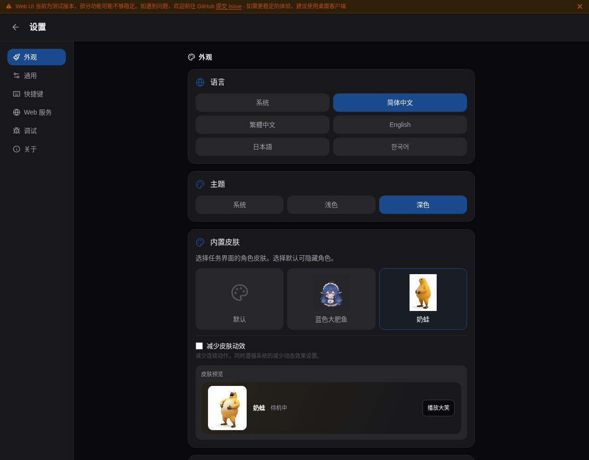
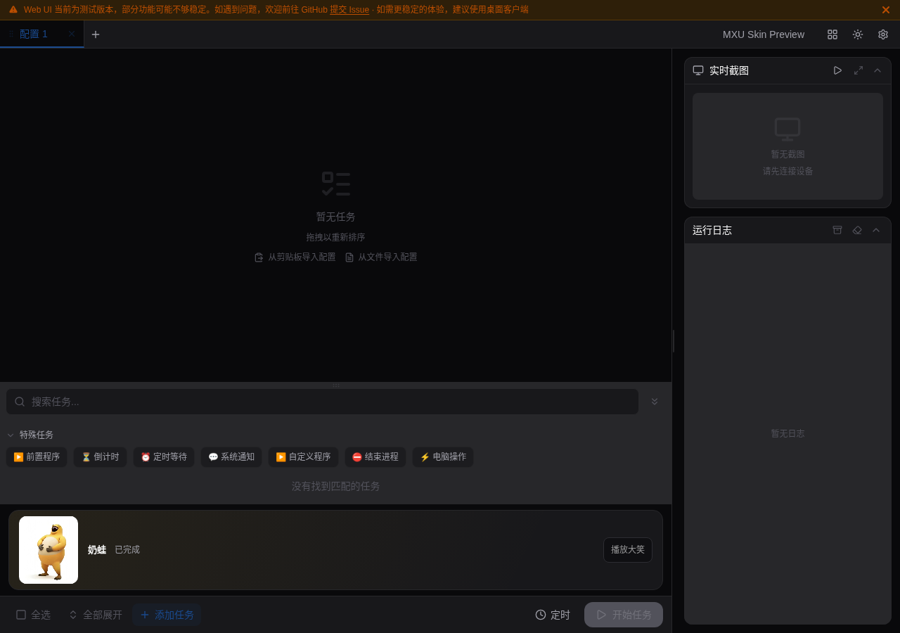
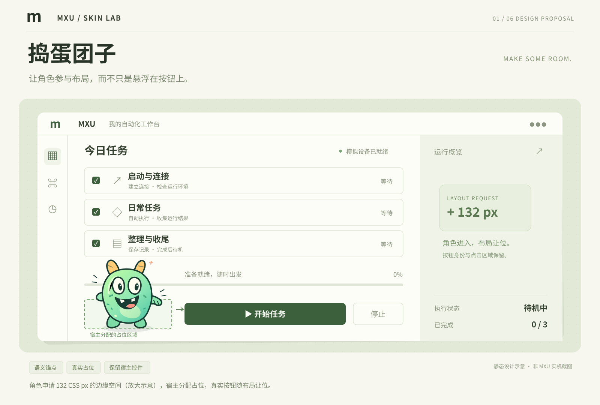
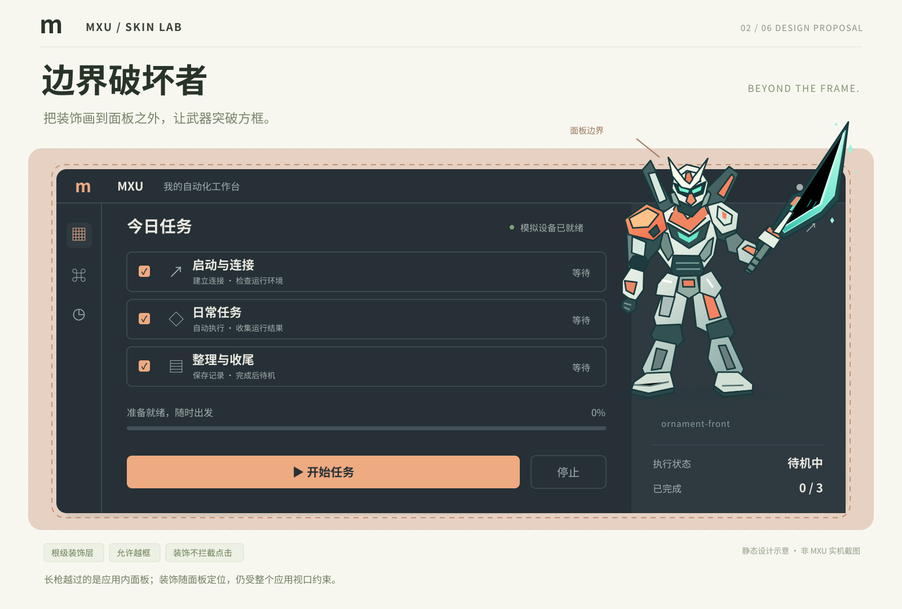
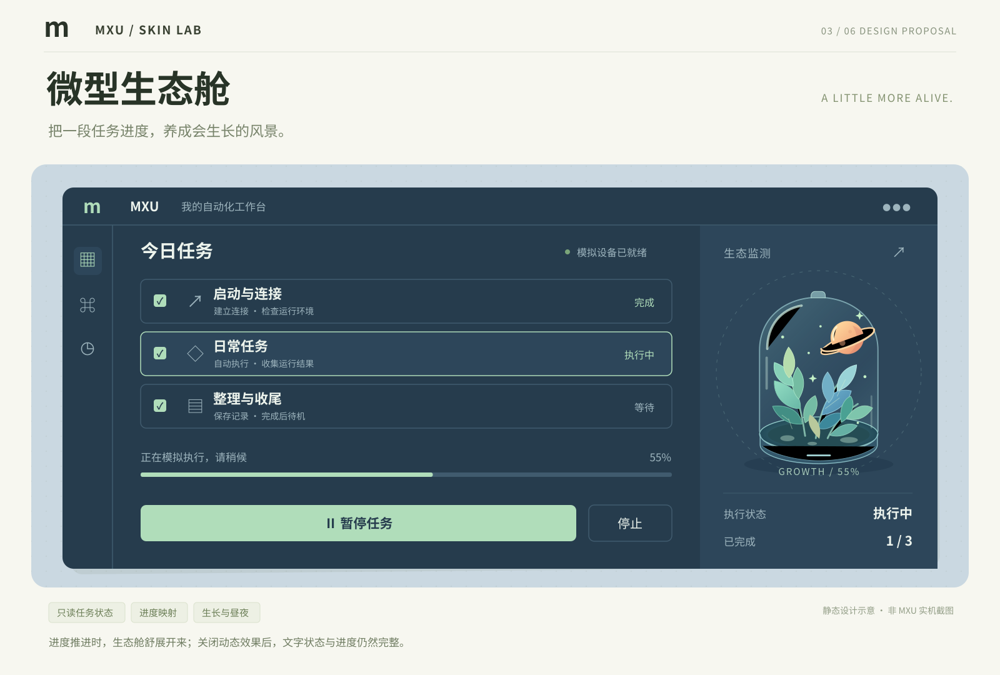
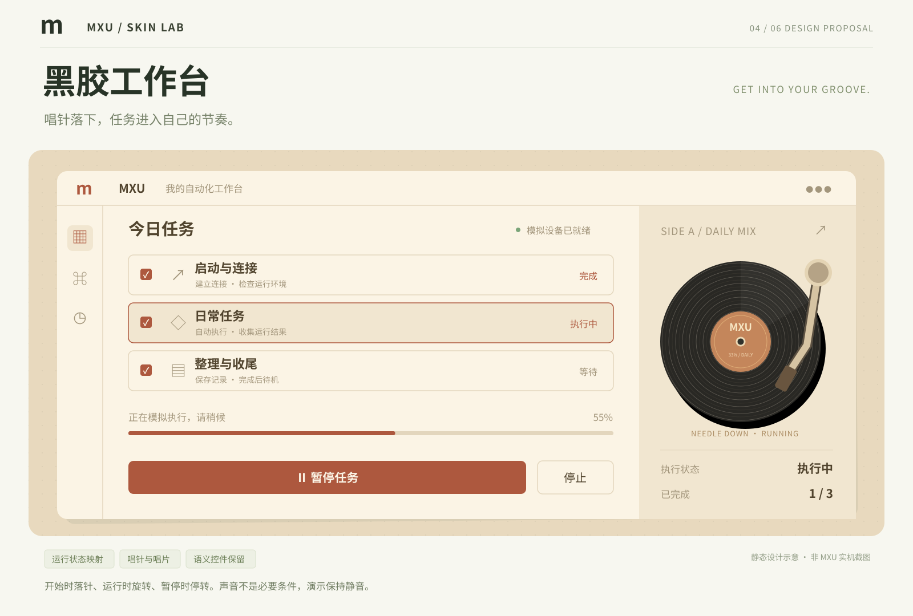
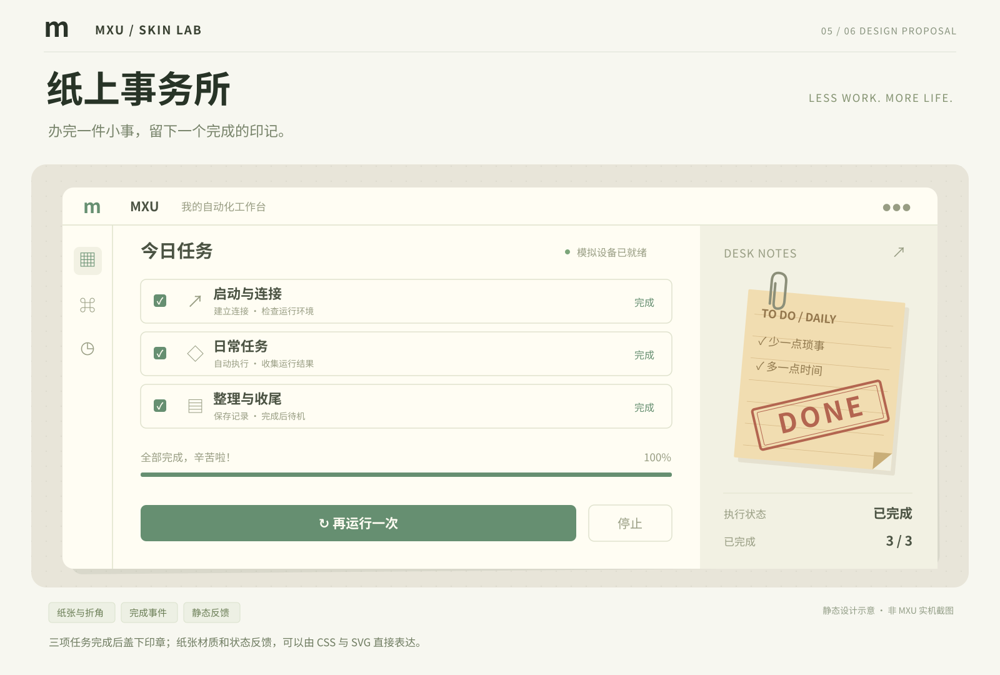
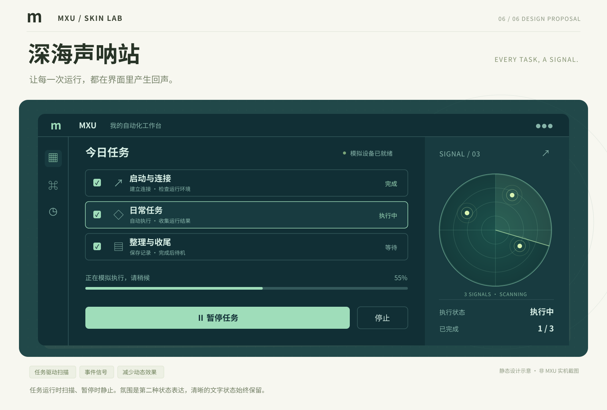
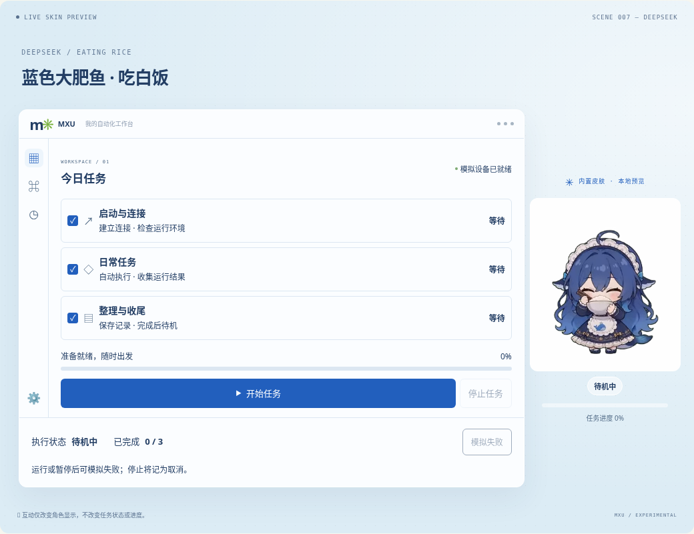
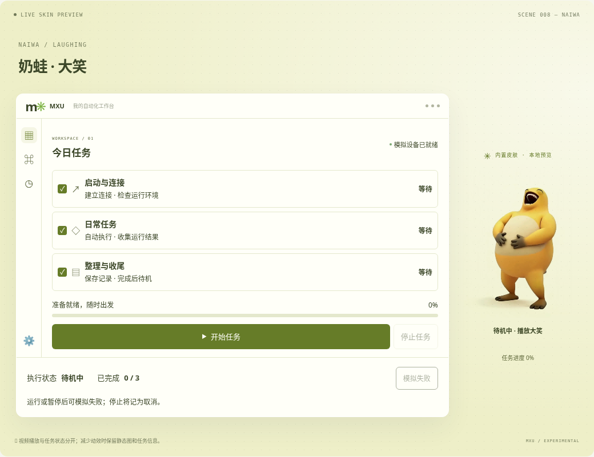

# MXU 皮肤系统设计讨论

**当前状态：通用皮肤协议仍为设计提案；白饭鲸鱼娘与奶蛙已作为两套可信内置皮肤接入 MXU 设置与任务主视图。** 本目录另保留八场景离线概念 demo，用于讨论协议能力与交互。字段、命名和分级尚未冻结，当前内置接入不等于完整 L0/L1 运行时。

建议复用 MXU 已有的 React / Tauri Web 渲染能力，用 HTML、CSS、SVG 表达皮肤，再由 MXU 提供包加载、稳定锚点、布局占位、装饰图层和状态事件。普通作者可以只换颜色；复杂作者可以让角色挤开按钮、让机甲武器伸出面板，或让任务状态变成界面里的故事。

这是通用皮肤协议，不是特定皮肤评选。MXU 内置、项目随包附带和用户自行导入都是目标来源；项目附带场景也须通过第三方内容校验，来源不扩大权限。先实现 L0 与宿主契约、再验证内置 L1，第三方场景等隔离、专用安装与恢复门槛完成后开放，具体版本节奏尚未冻结。

- [完整协议草案](protocol.md)
- [24 条扩展创意](ideas.md)
- [交互 demo 源码入口](demo/index.html)
- [Manifest 示例](demo/examples/mascot.skin.json)（仅清单草案，不能直接安装）
- [白饭鲸鱼娘与奶蛙：离线入口、预设及素材来源](meme-skins.md)
- [PR Review 核对与本轮处理](review-notes.md)

## 主程序中切换内置皮肤

进入 **设置 → 外观 → 内置皮肤**，可选择默认、蓝色大肥鱼吃白饭或奶蛙，并调整皮肤的减少动效设置。原有的跟随系统 / 浅色 / 深色、强调色、自定义强调色与背景图选项继续独立生效。选择默认会移除角色卡片。

两套角色在任务主视图的工具栏前以普通布局卡片显示，设置页提供预览；切换只更新外观，不启动、停止或重置业务任务。主程序只读活动实例的运行事实：运行中优先，其次显示整批成功或失败，其余为待机。没有暂停、取消或百分比进度的事实来源时，不从离线 demo 复制这些状态。

角色只展示既有公开素材中的动作，不添加对白、拟声台词或额外剧情。旁边的文字是宿主任务状态和操作提示。

桌面端通过现有项目外观配置保存 `skinId` 与 `skinReducedMotion`；WebUI 使用浏览器本地外观存储，保存其他配置时保留后端原始皮肤值，避免覆盖桌面选择。资源来自随前端打包的 `src/assets/skins/`，由宿主 React 组件渲染，不读取作者 HTML、脚本或第三方皮肤包。

通用 Manifest 解释器、锚点协商、越框图层、第三方安装与隔离仍是后续工作；本次内置卡片不对这些能力作实现承诺。

下面为主程序 WebUI 的受控后端测试截图：

| 设置中的皮肤选择与预览 | 任务视图中的奶蛙 |
| --- | --- |
|  |  |

## 离线 Demo 的八个场景

下图均为**静态设计示意，非 MXU 实机截图**。它们使用 demo 的场景素材来展示设计方向；动画和交互请运行本目录中的 demo 查看。

| 捣蛋团子：角色申请真实占位                                          | 边界破坏者：装饰越过面板边框                                             |
| ------------------------------------------------------------------- | ------------------------------------------------------------------------ |
|  |    |
| 微型生态舱：状态驱动生长                                            | 黑胶工作台：运行与暂停的视觉隐喻                                         |
|  |  |
| 纸上事务所：材质与完成反馈                                          | 深海声呐站：状态成为环境氛围                                             |
|             |                  |

前六套概念图同时保留同名 SVG 源文件，可用矢量编辑器修改；PNG 便于 GitHub 直接预览。

新增两套网络热梗场景：**白饭鲸鱼娘**使用蓝发、鲸鳍、鲸尾、蓝白女仆装与白饭碗；**奶蛙**采用实际社区原片中的三维黄色大肚形态，保留浅色肚皮、绿色眼睛、圆滑有肉的四肢及深褐手脚掌，主动作是仰头捧腹大笑。离线 demo 的角色互动与模拟任务事实分开，失败和取消时优先保留明确状态。两套均为非官方二创场景，不代表相关品牌或原作的官方皮肤。

白饭鲸鱼娘直接采用 [PC2005-cloud/dsh-pet 的既有社区吃白饭动画](https://github.com/PC2005-cloud/dsh-pet/blob/33938a355f422525886c3facd883d7179c58ebf4/dsh-pet/assets/webm/%E5%90%83%E7%99%BD%E9%A5%AD.webm)和同源视频的透明静态帧。原动画转为白底无声 H.264，保留原动作；素材按来源注明的 CC BY-NC-SA 4.0 保留 PC2005-cloud、原型作者上善无形和女仆版设计者 ZipZipPipe 的署名。奶蛙使用本地保存且已移除音轨的社区大笑视频、本地海报与原片第 1 秒的闭口静态截帧。最终两套均使用公开动作素材与原片截帧，不包含本次生成或重绘的角色图。素材来源、处理与权利状态详见 [两套皮肤说明](meme-skins.md)；代码许可不覆盖这些媒体，运行时无需访问来源网站。

下面是本轮离线 Demo 的浏览器截图，均非 MXU 主程序截图：

| 白饭鲸鱼娘 | 奶蛙 |
| --- | --- |
|  |  |

[观看奶蛙皮肤的静音动态预览](images/08-naiwa-preview.mp4)。

## 本地查看离线 Demo

下载或检出本 PR 的文件，用浏览器打开 `docs/design/skin-system/demo/index.html` 即可离线体验，不需要安装前端依赖，也不需要运行 MXU、Tauri 或 MaaFramework。GitHub 文件预览本身不会执行 HTML。

若浏览器的管理策略禁止 `file://`，可在本目录运行 `python -m http.server 8765`，再打开 `http://localhost:8765/demo/index.html#naiwa`；所有运行素材仍从本机加载。

演示支持八种场景切换、勾选模拟任务、开始 / 暂停 / 继续 / 停止取消、模拟失败与重试、宿主状态摘要、场景参数调整、布局边界显示，以及减少动效。页面下方还有 24 条可按类别筛选的扩展创意。

可直接打开 [白饭鲸鱼娘](demo/index.html#deepseek) 或 [奶蛙](demo/index.html#naiwa)。新增两套的角色互动持续约 2.4 秒，重复触发仅重置同一互动计时器；暂停和终态会接管角色反馈。奶蛙视频在减少动效、页面隐藏、离开页面或切到其他场景时停止，静态姿态与任务文字仍保留；本 demo 不播放音频。

鲸鱼娘原片为 VP9 alpha，随包版本已转为白底 H.264，以避免不支持透明 WebM 的平台出现黑底；减少动效或播放失败时使用同源静态帧。浏览器验证仍不代表三种原生 WebView 都已通过验证。

可以导出 `mxu-skin-demo/0.1` JSON 预设，修改 `name`、`accent` 或场景允许范围内的 `intensity` 后导入。此入口只接受有限的内置场景配置，不加载第三方 HTML/CSS/JS，**不等于拟议的 `.mxuskin` 安装器**。

## 这轮想讨论什么

1. **表达范围**：L0 主题变量 + L1 声明式场景是否足够覆盖第一批皮肤？哪些真实需求必须有 L2 隔离脚本？
2. **宿主控件**：是否接受“保留真实业务控件，公开样式变量、锚点与有限槽位”的边界？完整重排任务卡片应放到哪一级？
3. **布局与越框**：先支持边缘占位和面板 inset 是否足够？哪些区域必须禁止装饰遮挡？
4. **隔离方案**：Tauri 各平台 WebView 与 WebUI 能否共用无原生权限的装饰 renderer？iframe、受控渲染器或其他方案如何取舍？
5. **作者体验**：包结构、能力声明、预览调试和文档怎样做，才能让只会写一点 CSS 的作者也容易入门？
6. **玩法与风格**：欢迎提出新的角色行为、材质、控件隐喻、任务状态反馈，或直接画草图；不局限于本次八种风格。

## 生成与可复现检查

打开 demo 不需要安装任何依赖。仅在修改文档或运行开发检查时，需要 Node.js 20+：

```sh
cd docs/design/skin-system
npm ci
npm run check
```

- `protocol.md` 是协议正文唯一来源，由生成器输出 `demo/protocol.html`，包含完整目录和相对链接。
- `ideas.json` 是 24 条创意唯一来源，生成 `ideas.md` 和 `demo/ideas.js`，网页与文档共用稳定编号。
- 编辑源文件后运行 `npm run generate`，再运行 `npm run check`。不要手工编辑派生文件。
- 本目录的开发依赖与锁文件只用于设计工件检查，不加入 MXU 主程序依赖。

浏览器检查使用 Playwright：安装 Chromium（`npx playwright install chromium`）后运行 `npm run check:browser`。也可设置 `CHROMIUM_PATH` 使用已安装的浏览器；脚本优先使用本机 `/usr/bin/chromium`。设置 `SKIN_BROWSER_OUTPUT` 可保存两套新场景截图。

主程序接入另用 `npm run check:integration` 验证，先在仓库根目录安装前端依赖，再在本目录 `npm ci`。此脚本启动真实 Vite/React App，以受控 HTTP/WebSocket 后端替代设备服务；检查设置选择、刷新恢复、任务状态、静音视频、减少动效及五种窗口尺寸。`SKIN_INTEGRATION_OUTPUT` 可指定截图目录。

## 当前验证范围

检查覆盖派生文件一致性、Manifest 与文档样例、资源链接、DOM/事件、成功/失败/取消/重试、互动超时与清理、媒体播放生命周期、预设输入校验与基础可访问性语义；静态概念图及 SVG 也做过导出检查。浏览器实测仅说明本次测试的浏览器与视口，不能替代跨平台 WebView 测试或生产级隔离验证。

离线 demo 通过 37 组文档/DOM/事件检查与 18 项 Chromium 155 浏览器检查。新两套覆盖 1440×1100、850×525、680×420、566×350 与 390×844；其中 680×420、566×350 分别模拟 850×525 窗口在 125%/150% 缩放下的有效 CSS 空间，不能替代原生 WebView 缩放测试。检查包含装饰与真实按钮不相交、无横向溢出、模拟任务反馈及两份原动作视频的独立播放生命周期。受管理浏览器阻止 `file://`，该项明确跳过，本地 HTTP 路径已验证。这些数字不作为主程序内置皮肤接入的测试结果。

本轮主程序通过 `pnpm build`；`pnpm test` 为 127 项通过、1 项既有平台跳过、无失败；真实 App 的 Chromium 集成检查 11 项通过。回归包含空实例配置也恢复外观、首次 WebUI 换肤保留原明暗/语言/强调色、浏览器与桌面外观隔离、换肤不改运行任务、原片吃饭动作播放和减少动效，以及五语言操作文案一致性与无对白约束。尚未执行原生 Tauri 三平台实机验证。

离线 demo 是独立的可信场景，切换场景会重置模拟任务；主程序的内置皮肤切换保持实际业务任务继续执行。正式 `.mxuskin` 导入、能力协商、实际占位结果回传、保护区裁切与权限隔离仍是待实现的设计内容。

静态概念图是设计快照，不用于验证最新 demo 的 CSS 几何或可访问性。

本目录的中文文案用于设计讨论与离线原型。主程序的内置皮肤设置与角色反馈文案使用项目现有 i18n 资源。

## 更多皮肤想法

另整理了 [24 条扩展创意](ideas.md)，包括任务小火车、错误框修理工、深夜拉面铺、火箭发射台和逐渐显影的照片。每条列出所需能力、建议层级与操作兜底，方便讨论哪些值得先做成内置皮肤。
